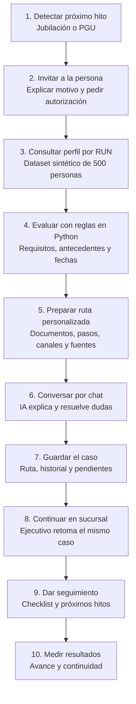

# Contexto compartido — ChileAtiende a Tiempo

Lectura de entrada para Claude Code y Codex. Resume el desafío institucional, las decisiones aceptadas y lo que realmente existe en el repositorio al 14-10-2026. Las reglas de trabajo siguen en [[AGENTS]]; el estado operativo se mantiene en [[board]].

## Fuentes y límites
- Presentación entregada: [bb-assets-dc11-presentation.pptx](../bb-assets-dc11-presentation.pptx), 7 diapositivas. El resumen siguiente proviene de su texto; las notas del presentador solo contienen números de página. No se inspeccionaron visualmente las diapositivas.
- Decisiones del equipo: [[0002-seleccion-reto]], [[0003-orquestacion-agente]], [[0004-mvp-jubilacion-pgu]] y [[arquitectura-chileatiende]].
- Datos: [[datos-dataset-A]] y `data/raw/dataset_A_participantes/README.md`.
- Revisión de Claude: commits `ae5fe79` y `69af73c`; este último tiene coautoría de Claude. No hay evidencia de otra implementación en los archivos actuales.
- Los datos institucionales, edades, ventanas y metas citados abajo se transcriben de la presentación: no se verificaron externamente. Antes de convertirlos en reglas, recuperar la fuente oficial, su vigencia y URL. Esta nota no establece elegibilidad legal ni concede beneficios.

## Desafío e institución (diapositivas 1–4)
Evento: AWS Breaking Barriers Chile 2026, 14–16 de octubre, Universidad de Chile, Beaucheff 851, Santiago. Institución: Instituto de Previsión Social (IPS) / ChileAtiende. Área: ciudadanía / gobierno digital.

Problema: hoy la persona debe descubrir beneficios, instituciones, documentos, plazos y orden de los trámites; al cambiar de canal repite su historia. Se busca pasar del trámite aislado al acompañamiento personalizado, anticipado y continuo.

Rosa, de 59 años, es una historia ficticia: se aproxima a jubilarse, desconoce AFP, PGU y SCOMP, visita oficinas y descubre documentos faltantes sin saber cuál es el siguiente paso. El PPT atribuye estas barreras a un estudio de experiencia usuaria al pensionarse de 2025, pero no incluye el informe ni su URL. Debe solicitarse para citarlo en un pitch.

La misión descrita es acercar beneficios, trámites e información mediante una red nacional, inclusiva y multicanal. La oportunidad es conectar los canales existentes alrededor de la persona.

| Contexto reportado en el PPT | Valor | Alcance |
|---|---|---|
| Campañas de contactabilidad de 2025 | 40 | Contexto institucional |
| Mensajes enviados | 2,468 millones | Contexto institucional |
| Contacto efectivo | 85%; 2,105 millones de contactos | Referencia histórica |
| Personas atendidas | 256.729 | Canales asistidos y autoatención |
| Solicitudes PGU asociadas a campañas | 15.241 | Campañas focalizadas de Leyes Reparatorias; no demuestra causalidad exclusiva |
| Personas de 65+ | 2.587.238 | Censo 2024; no equivale a elegibilidad |
| Personas que recibían PGU | 2.243.121 | Diciembre de 2025 |
| Nuevas personas pensionadas | 187.799 | Año 2025 |

No restar universos con fechas y definiciones diferentes para afirmar cuántas personas pierden PGU. Ninguna cifra institucional es un resultado de nuestra aplicación.

## Experiencia objetivo (diapositiva 5)
1. **Detectar** un hito próximo con señales y datos cuyo uso esté autorizado.
2. **Invitar**: explicar por qué se contacta y permitir aceptar o declinar.
3. **Autorizar**: explicar fuentes y finalidad, y pedir permiso para datos adicionales.
4. **Preparar la ruta**: qué revisar, qué falta, documentos, plazos y canal.
5. **Acompañar**: guardar contexto, resolver dudas y continuar entre canales.
6. **Cerrar y anticipar**: el organismo informa su decisión; explicar siguientes pasos e hitos.

La IA explica y organiza. AFP, IPS y los organismos competentes validan requisitos y resuelven. La demo debe distinguir orientación preliminar, estado simulado y decisión institucional; no presentar una evaluación del código como adjudicación de PGU.

El PPT propone invitar aproximadamente un año antes de la edad legal de vejez; indica mujeres 60 y hombres 65. Para PGU indica solicitud desde **64 años y 9 meses**, acceso desde **65 si cumple requisitos**. Son hitos distintos: no usar 65 como única fecha para toda jubilación ni convertir la apertura de solicitud en un vencimiento. Verificar estas afirmaciones en fichas oficiales antes de implementarlas.

Seguimiento: checklist, antecedentes con autorización, estado informado por el organismo y siguiente paso. La persona conserva el contexto al cambiar de canal. Futuras extensiones: nacimiento, matrimonio, primer empleo, estudios, vivienda, cesantía, discapacidad, cuidados y fallecimiento.

## Pipeline del MVP

Flujo objetivo de **ChileAtiende a Tiempo**, con foco en jubilación + PGU. Describe el comportamiento esperado al completar el MVP; la implementación sigue pendiente según [[board]].

La detección inicial utiliza únicamente señales cuyo uso esté autorizado. La consulta ampliada del perfil ocurre después de la aceptación y autorización; si la persona declina, no continúa ese flujo. Para la demo, la invitación y el seguimiento pueden simularse en las vistas locales.

La evaluación devuelve `elegible` (orientación preliminar), `no_elegible`, `antecedente_faltante`, `proximo` o `ya_recibe`, con motivos y fuentes. La decisión oficial corresponde al organismo. Los datos nuevos pueden requerir volver a evaluar y actualizar la ruta del mismo caso.

**Pipeline técnico:** chat y panel del ejecutivo → API FastAPI → agente Bedrock Converse → herramientas Python + catálogo oficial → repositorio de casos. Primero ejecución local con memoria; después despliegue opcional con Lambda, API Gateway, S3 y DynamoDB. Ver detalle en [[arquitectura-chileatiende]].

**Demo de punta a punta:** una persona próxima a cumplir 65 acepta la orientación, recibe su ruta PGU y luego un ejecutivo abre el mismo caso, ve qué falta y continúa sin pedirle que cuente todo otra vez. Mostrar el checklist y el siguiente paso; medir si el contexto se conserva y si la ruta queda completa, separando resultados simulados de impacto real.

## Medición propuesta (diapositiva 6)
| Indicador | Definición o referencia | Meta propuesta |
|---|---|---|
| KPI principal | Personas invitadas que completan el próximo paso válido dentro del plazo informado | ≥70% |
| Comprensión | Identifica trámite/beneficio y próximo paso; levantar línea base en piloto | ≥80% |
| Continuidad | Casos derivados conservan contexto mínimo necesario; levantar línea base | ≥90% |
| Contacto efectivo | Invitación recibida por canal válido, con aceptación o rechazo; referencia IPS 85% | Mantener o mejorar |

Son hipótesis del piloto, pendientes de validación institucional, no resultados ni compromisos aprobados. Medir personas/casos y definir denominadores, plazo observado y evidencia del paso completado. Una conversación simulada puede medir funcionamiento, pero no demuestra impacto real ni comprensión de usuarios reales.

Complementar con métricas técnicas del equipo: rutas completas, detección de antecedentes faltantes, candidatos preliminares y próximos hitos sobre el dataset. Separar estos indicadores de los KPI del piloto.

## Referente institucional (diapositivas 1 y 7)
Mauricio Miranda Lagos, Coordinador Plataformas Cloud. Correo: `Mauricio.Miranda@ips.gob.cl`; teléfono indicado: `+569 51014001`. Se registra para contexto; no se ha contactado al referente.

## Decisiones aceptadas y arquitectura
- Reto elegido: [[ChileAtiende-a-tiempo]]. MVP: **jubilación + PGU** de punta a punta; nacimiento y cesantía son extensiones.
- Demo mínima: chat web de la persona y panel del ejecutivo sobre **el mismo caso**, con ruta, antecedentes y próximos pasos.
- Bedrock **Converse + tool use propio**, según [[0003-orquestacion-agente]]. El LLM conversa, pide datos y explica con citas; reglas de elegibilidad y fechas en funciones Python deterministas.
- Herramientas previstas: `consultar_perfil`, `evaluar_pgu`, `buscar_beneficios`, `calcular_plazos`, `guardar_caso`, `leer_caso`.
- FastAPI: `POST /cases`, `POST /cases/{id}/messages`, `GET /cases/{id}`. Repositorio en memoria primero; DynamoDB después. Catálogo JSON local y posteriormente S3. Lambda + API Gateway con Mangum; CDK Python. Alertas con EventBridge Scheduler si alcanza el tiempo.
- Streamlit es la opción por defecto mencionada para frontend, todavía pendiente. Búsqueda simple sobre JSON prevista; Knowledge Bases y Amazon Connect son opcionales.
- Perfil AWS `hackaton`, región `us-east-1`. Según las notas del equipo: Sonnet `us.anthropic.claude-sonnet-5`, Opus `us.anthropic.claude-opus-5`, Haiku `us.anthropic.claude-haiku-4-5`; `*-5-5` y Fable bloqueados. Acceso reportado previamente, no comprobado en esta revisión. Credenciales STS pueden expirar.
- Python 3.12, uv, ruff y pytest. Nunca credenciales en git. Notas y commits en español; identificadores en inglés.

## Dataset y evaluación
500 personas **sintéticas**, semilla 20261008, fecha de referencia **2026-10-08**. Archivos unidos por `run`; `perfiles.json` integra Registro Civil, RSH, residencia, migración, previsión, pensiones y situación laboral. RUN válidos pero fuera del rango asignado; AFP y otros identificadores ficticios.

Ausencia de RSH/residencia/PFP puede impedir evaluar; no afiliación previsional y ausencia de información laboral no bloquean por sí solas. Sin pensiones/beneficios en el origen significa que no recibe ninguno, según el README. `pfp_percentil` y `pafe_estimada` son simulaciones; no fórmulas oficiales.

Resultados previstos: `elegible`, `no_elegible`, `antecedente_faltante`, `proximo`, `ya_recibe`. Falta definir precedencia cuando concurren varios motivos. Revisar `estado = vigente` para PGU; la presencia de un registro terminado no equivale a recibirla.

Conteos **preliminares de Claude**, no reevaluados en esta revisión: 480 vivos y 20 fallecidos; 58 vivos de 65+, 56 sin PGU registrada, 37 candidatos por residencia/PFP aún sin revisar pensión base, 4 con antecedentes faltantes y 17 que cumplen 65 en 12 meses. Deben recalcularse con reglas verificadas y fecha explícita; no son 37 beneficios concedidos ni un resultado definitivo.

El dataset no trae una tabla de parámetros PGU. Faltan montos, umbrales y vigencias con `fuente_url`. La nota anterior propone sumar pensiones vigentes para pensión base: validar la definición oficial y el tratamiento de `pafe_estimada`, PGU y otros beneficios antes de codificar. Tampoco inventar una vigencia universal del RSH sin fuente.

## Qué hizo Claude y estado comprobado
Claude dejó estructura de vault, selección del reto, arquitectura, ADR 0001–0004, tablero, bitácora y análisis del dataset. El commit `69af73c` versionó `data/raw/` y ajustó el MVP a jubilación + PGU. Los ADR 0003 y 0004 están aceptados; la bitácora conserva menciones antiguas a «propuesta», superadas por la aprobación posterior.

**Todavía no hay aplicación implementada**: no existen `src/`, `infra/`, `data/catalogo/`, `pyproject.toml` ni tests. Los componentes del diagrama son objetivos, no servicios desplegados. El tablero tiene 17 tareas abiertas previas a esta revisión. No se ejecutaron pytest ni comprobaciones AWS: no hay suite y no era parte de esta revisión acceder a la cuenta.

## Pendientes y orden de ejecución
1. **Humano + Claude**: obtener fuentes oficiales de PGU y jubilación, parámetros con vigencias, esquema de catálogo y aclarar reglas de pensión base. Preguntar a mentores por dataset B, evaluación del uso de datos y disponibilidad de Connect.
2. **Codex**: scaffold Python y tests; `consultar_perfil`; `evaluar_pgu` con cinco estados y casos límite; evaluación reproducible de los 500 perfiles. No sustituir parámetros faltantes por valores inventados.
3. **Codex**: hitos/fechas verificadas y búsqueda de beneficios; catálogo de solicitud de pensión y bono por hijo sujeto al esquema de Claude.
4. **Claude**: bucle Converse por CLI con citas, límite de iteraciones y manejo de errores.
5. **Codex + Claude**, en archivos separados: repositorio de casos y API; frontend ciudadano/ejecutivo. Incorporar aceptación/rechazo, finalidad del uso de datos, autorización y checklist a los contratos antes de conectar ambas vistas.
6. **Claude**: simulador con Haiku y reporte técnico; definir cómo medir avance, comprensión y continuidad sin atribuir impacto real a simulaciones.
7. **Humano**: guion de demo y pitch; confirmar hora de entrega (el tablero menciona viernes antes de 10:15, dato no confirmado por este PPT). **Codex**: CDK/despliegue opcional después de demo local funcional.

Brechas detectadas respecto al PPT: el tablero original no contemplaba explícitamente autorización, apertura PGU a los 64 años y 9 meses, preparación por edad de jubilación según perfil, checklist ni KPI de próximo paso. Se añaden tareas de diseño/verificación; no cambian automáticamente los ADR aceptados.

## Uso por ambos agentes y verificación
Leer [[AGENTS]], esta nota, [[board]] y la bitácora vigente al iniciar. Reservar tareas antes de editar, usar ramas `claude/<tarea>` o `codex/<tarea>` y no trabajar a la vez sobre el mismo archivo. Terminar con ejecución local, test/script y nota enlazada. Esta revisión usa `codex/contexto-hackaton`.

Para volver a extraer los 7 slides sin dependencias externas: `powershell -NoProfile -ExecutionPolicy Bypass -File scripts/extract-ppt-context.ps1`. `Bypass` aplica solo al proceso porque este entorno deshabilita scripts por defecto. El script falla si no encuentra diapositivas o texto; conserva el orden numérico y une fragmentos de texto de cada párrafo. No extrae imágenes, diseño ni verifica las fuentes institucionales. Si cambia el PPT, actualizar esta nota y la bitácora.
