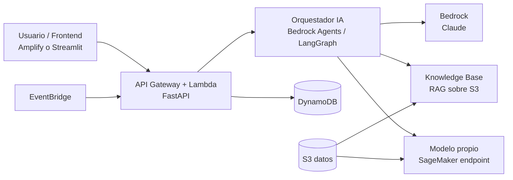

# Arquitectura base (agnóstica al reto)

Plantilla genérica. **Ya está adaptada al reto elegido en [[arquitectura-chileatiende]].**

## Capas
1. **Ingesta**: S3 + Lambda/Glue para limpiar datos del reto.
2. **Inteligencia**: LLM vía Bedrock (razonamiento, extracción, RAG) + modelo propio si hay datos estructurados o imágenes.
3. **Orquestación**: Bedrock Agents (rápido de montar) o LangGraph en Lambda (más control).
4. **Producto**: frontend mínimo para la demo; la demo manda.
5. **Observabilidad**: CloudWatch + logs de prompts para depurar.

## Decisiones pendientes
- [ ] Bedrock Agents vs LangGraph → ADR
- [ ] Frontend: Streamlit (rápido) vs React/Amplify (más pulido) → ADR
