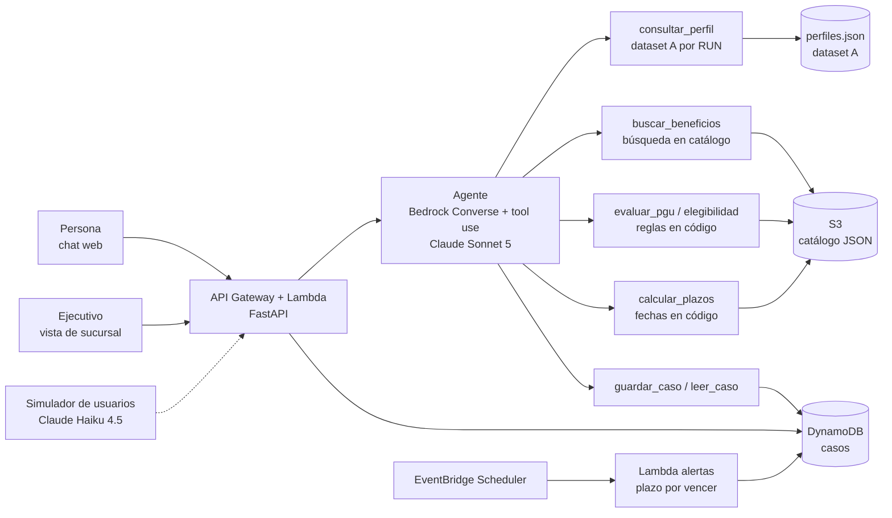

# Arquitectura — ChileAtiende a tiempo

Adaptación de [[arquitectura-base]] al reto [[ChileAtiende-a-tiempo]]. Las decisiones están en [[0002-seleccion-reto]], [[0003-orquestacion-agente]] y [[0004-mvp-jubilacion-pgu]]. Los datos se describen en [[datos-dataset-A]].

## Componentes
0. **Perfiles ciudadanos** (`data/raw/dataset_A_participantes/perfiles.json`, luego S3 o DynamoDB): simulan la interoperabilidad con Registro Civil, RSH, residencia, previsión e IPS. La herramienta `consultar_perfil(run)` devuelve el perfil de una persona.
1. **Catálogo** (`data/catalogo/*.json`, luego S3): un JSON por beneficio con `id`, `nombre`, `evento`, `requisitos` (reglas evaluables), `plazo` (relativo a la fecha del evento), `pasos`, `canal` y `fuente_url`.
2. **Agente** (`src/agent/`): bucle de Bedrock Converse con tool use. Conversa, pide los datos que faltan, llama a las herramientas y redacta la ruta citando `fuente_url`.
3. **Herramientas** (`src/tools/`): funciones Python puras y testeables. La elegibilidad y los plazos se calculan siempre aquí, nunca en el LLM.
4. **Caso** (DynamoDB, tabla `cases`): `case_id`, evento, fecha del evento, datos declarados, ruta (beneficio, estado, fecha límite) e historial por canal. Es lo que da continuidad entre canales.
5. **API** (`src/api/`, FastAPI): `POST /cases`, `POST /cases/{id}/messages` y `GET /cases/{id}`. Se ejecuta local con `uv run` y en AWS con Lambda + API Gateway (Mangum).
6. **Frontend** (`src/web/`): dos vistas sobre el mismo caso, el chat de la persona y el panel del ejecutivo con la ruta y los plazos.
7. **Alertas**: Lambda diaria que marca los plazos a menos de N días de vencer. En la demo basta con mostrarlas en el panel.
8. **Simulador** (`src/sim/`): genera N personas sintéticas por evento con Haiku 4.5, las hace conversar con la API y calcula las métricas del pitch.

## Modelos (allowlist de la cuenta del evento)
| Uso | Modelo |
|---|---|
| Agente | `us.anthropic.claude-sonnet-5` |
| Simulador y tareas baratas | `us.anthropic.claude-haiku-4-5` |
| Respaldo para razonamiento difícil | `us.anthropic.claude-opus-5` |

Los modelos `*-5-5` y Fable no están permitidos en la cuenta.

## Orden de construcción
1. `consultar_perfil` + parámetros PGU + `evaluar_pgu` con tests sobre perfiles del dataset (sin LLM).
2. Evaluación por lotes de los 500 perfiles, para obtener las métricas del pitch.
3. Agente local por CLI usando las herramientas.
4. API + repositorio de casos (en memoria detrás de una interfaz, luego DynamoDB).
5. Frontend con las dos vistas.
6. Simulador de usuarios.
7. Despliegue en AWS con CDK si alcanza el tiempo. La demo puede correr local.

## Decisiones pendientes
- [x] Orquestación: Converse + tool use propio → [[0003-orquestacion-agente]] (aceptada)
- [ ] Frontend: Streamlit (rápido, opción por defecto) vs React → ADR si se cambia
- [ ] Búsqueda: Bedrock Knowledge Base vs búsqueda simple sobre el catálogo JSON. Con 15 a 30 beneficios, la búsqueda simple alcanza.
- [ ] Canal telefónico con Amazon Connect: solo si hay acceso y sobra tiempo
