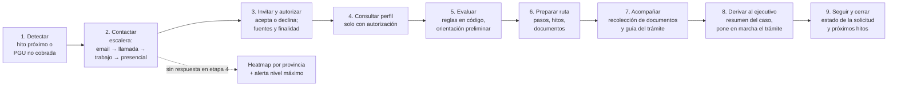
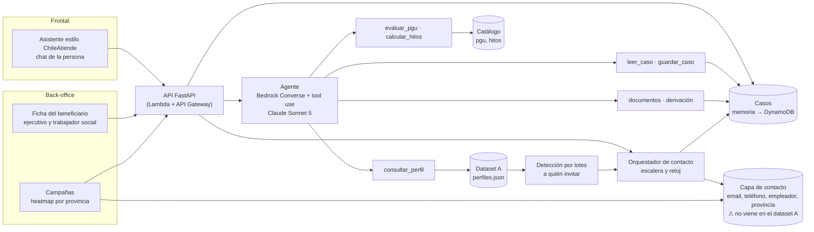

# Arquitectura — ChileAtiende a tiempo

> **Reestructurada el 14-10** según [[0005-asistente-contacto-escalonado]]: asistente frontal estilo ChileAtiende, contacto escalonado (email → llamada → trabajo → puerta a puerta), campañas por heatmap y acompañamiento completo con back-office. El detalle de contacto y campañas está en [[contacto-y-campanas]].

Decisiones previas que se mantienen: [[0002-seleccion-reto]], [[0003-orquestacion-agente]] y [[0004-mvp-jubilacion-pgu]]. Datos en [[datos-dataset-A]].

## Pipeline medular

## Vista de componentes

## Componentes
| # | Componente | Qué hace | Estado |
|---|---|---|---|
| 1 | **Asistente frontal** (`src/web/`) | Chat con la experiencia de la página de ChileAtiende; guía el trámite de punta a punta | Por hacer |
| 2 | **Agente** (`src/agent/`) | Converse + tool use: conversa, consulta, evalúa, arma la ruta y acompaña | En `main` ([[T04-agente]]); faltan las herramientas de documentos y derivación |
| 3 | **Contratos** (`src/contracts/`) | Modelos compartidos | En `main` ([[T02-contratos]]); hay que ampliarlos (ver [[contacto-y-campanas]]) |
| 4 | **Perfil autorizado** (`src/tools/`) | Consulta por RUN solo con autorización | En `main` ([[T03-consultar-perfil]]) |
| 5 | **Reglas** (`src/rules/`) | Evaluación PGU e hitos, en código | Por hacer |
| 6 | **Detección por lotes** | Recorre los perfiles y genera alertas: a quién invitar y por qué | Por hacer |
| 7 | **Colador de contacto** | Email a todos → llamada → trabajo → asistencia presencial; pasa a la etapa siguiente quien no inició su trámite. Reloj simulado y registro de intentos | Por hacer |
| 8 | **Heatmap de campañas** | Ranking y mapa por provincia de quienes no respondieron a ninguna etapa | Por hacer |
| 8b | **Alerta de beneficio** | Nivel por etapa; "nivel máximo" visible al ingresar el RUN en ChileAtiende y, con mensaje mínimo, en CESFAM | Por hacer |
| 9 | **Casos** (API + repositorio) | Caso único por persona: contactos, consentimiento, ruta, documentos, solicitudes, mensajes por canal | Por hacer |
| 10 | **Back-office** | Ficha del beneficiario para ejecutivo y trabajador social: qué se recopiló, de dónde y en qué estado está cada solicitud | Por hacer |
| 11 | **Simulador y medición** | Personas simuladas con Haiku 4.5; métricas técnicas separadas de los KPI del piloto | Por hacer |

## Modelos (allowlist de la cuenta del evento)
| Uso | Modelo |
|---|---|
| Agente | `us.anthropic.claude-sonnet-5` |
| Simulador, resúmenes y tareas baratas | `us.anthropic.claude-haiku-4-5` |
| Respaldo para razonamiento difícil | `us.anthropic.claude-opus-5` |

Los modelos `*-5-5` y Fable no están permitidos en la cuenta.

## Orden de construcción sugerido
1. Ampliar los contratos (canales de contacto, intentos, documentos, solicitudes) y conseguir la capa de contacto (pedirla o generarla sintética).
2. Reglas PGU e hitos + detección por lotes.
3. Orquestador de contacto con reloj simulado.
4. Asistente frontal conectado al agente, con documentos y derivación.
5. Back-office: ficha del beneficiario.
6. Heatmap de campañas.
7. Simulador, medición y despliegue en AWS si alcanza el tiempo.

## Decisiones pendientes
- [x] Orquestación: Converse + tool use propio → [[0003-orquestacion-agente]]
- [x] Idea central: asistente + contacto escalonado + heatmap + acompañamiento → [[0005-asistente-contacto-escalonado]]
- [ ] Capa de contacto: dataset de los mentores o capa sintética → [[contacto-y-campanas]]
- [ ] Base legal del contacto laboral y uso de la marca ChileAtiende: confirmar con los mentores
- [ ] Frontend: Streamlit (rápido) vs React (más parecido a la página de ChileAtiende) → ADR
- [ ] Envío real de emails y llamadas (SES, Amazon Connect) o solo simulado en la demo
