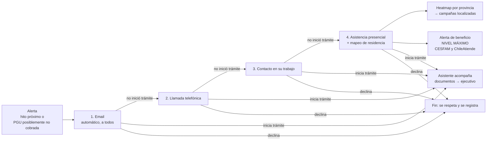

# Colador de contacto, campañas por provincia y alerta de beneficio

Diseño de las piezas nuevas de [[0005-asistente-contacto-escalonado]]. Los plazos, probabilidades y umbrales de esta nota son **propuestas para la demo**, no parámetros institucionales.

## Idea: un colador de lo general a lo específico
Las personas beneficiarias tienen 65 años o más, y muchas tienen dificultades con lo digital, con escuchar el teléfono o con desplazarse. Por eso el contacto va **de lo más general y barato a lo más específico y costoso**:
- La etapa 1, el email, es la tarea más sencilla: se automatiza y llega a **todos** los beneficiarios detectados.
- Cada etapa siguiente cuesta más y llega a **menos personas**: solo a quienes quedaron en el colador.

**Criterio para pasar a la etapa siguiente:** la persona **no inició su trámite** dentro del plazo de la etapa. Abrir un email o contestar una llamada no basta; lo que cuenta es iniciar el trámite.



| Etapa | A quién llega | Se salta si… | Plazo antes de escalar (propuesta) |
|---|---|---|---|
| 1. Email | Todos los beneficiarios detectados | No hay email | 7 días |
| 2. Llamada | Quienes no iniciaron trámite tras el email | No hay teléfono | 3 intentos en 5 días |
| 3. Trabajo | Quienes siguen sin iniciar | No trabaja o no hay empleador | 7 días |
| 4. Presencial | Quienes no respondieron a nada | — (última etapa) | Según la campaña de su provincia |

Reglas:
- **Declinar detiene todo.** No se escala a quien dijo que no, y tampoco se le pone alerta de nivel máximo.
- **Una persona, un colador activo.** Si llega otra alerta para la misma persona, se suma a su caso.
- **Cada intento queda en el caso**: canal, fecha y resultado. Es lo que verá el ejecutivo.
- **El contacto laboral no revela nada**: el empleador solo recibe una solicitud para que la persona se comunique con ChileAtiende.
- **Mensajes pensados para personas mayores**: lenguaje simple, letra grande en el email, un número de teléfono para devolver el contacto y la posibilidad de que la acompañe una persona de confianza.
- **La demo usa un reloj simulado**, para mostrar en minutos un proceso que en la realidad dura semanas.

## Heatmap y campañas por provincia
**Objetivo:** campañas presenciales localizadas y eficientes, en vez de recorridos al azar sin resultados.

- **Unidad territorial:** provincia. Chile tiene 56. Es la escala para planificar campañas y no expone a nadie.
- **Valor de cada provincia:** personas en la etapa 4, ponderadas por prioridad. Pesan más la posible PGU no cobrada, un hito más próximo o un antecedente faltante.
- **Salida:** un ranking de provincias para la campaña (personas, prioridad y canal sugerido) más el mapa. El equipo de terreno decide.
- **Privacidad:** no se muestran provincias con menos de 5 personas. El mapa no tiene nombres ni direcciones; esos se entregan solo al equipo asignado a la visita.
- **Tecnología:** Streamlit con pydeck o folium, sobre los centroides de cada provincia (una tabla provincia → coordenadas).

## Alerta de beneficio
Cada persona del colador tiene un nivel de alerta, igual a la etapa a la que llegó. Si la persona aparece en un punto de atención, el funcionario ve la alerta.

| Nivel | Significado |
|---|---|
| 1–3 | En contacto por email, teléfono o trabajo |
| **Máximo** | No respondió a ninguna etapa: beneficio posiblemente no cobrado |

- **Dónde se ve:** en la sucursal o el call center de ChileAtiende, al ingresar el RUN en la ficha del ejecutivo; y en un **punto de atención de CESFAM**, con una consulta por RUN.
- **Qué muestra en un CESFAM:** solo "*Persona con un beneficio pendiente de revisar: derivar a ChileAtiende*". No muestra el beneficio, montos ni datos del perfil, porque el CESFAM pertenece a otro servicio, de salud.
- **Qué muestra en ChileAtiende:** el detalle completo del caso, como en la ficha del beneficiario.
- **Base legal pendiente:** compartir la alerta con salud requiere un convenio o una base legal (Ley 19.628 y la nueva Ley 21.719 de protección de datos). Hay que validarlo con los mentores. En la demo, la vista del CESFAM es una simulación.

## Implementación recomendada
Un **script de backend por lotes**, separado de la página. La página solo consume su resultado.

```
[backend · colador]                                   [página]
detectar → etapas 1–4 con reloj simulado → casos ──→ asistente: la persona llega con su invitación
                                │                   → ficha del ejecutivo: historial de contacto + alerta
                                ├→ heatmap por provincia → vista de campañas
                                └→ alerta nivel máximo → consulta por RUN (ChileAtiende / CESFAM)
```

- **Por qué en backend:** procesa a todos los beneficiarios sin que nadie abra la página. Es determinista y se puede probar. En AWS corre con EventBridge una vez al día; en la demo, con un botón o un comando que avanza el reloj.
- **Sin LLM en las decisiones:** las etapas, los plazos y los niveles van en código. El LLM (Haiku) solo redacta los textos del email y el guion de la llamada.
- **Dónde va:** junto al motor de [[revision-aporte-johann]] en `src/app/ruta/`, para reutilizar la detección de `reglas.py` y el SQLite de `casos.py`:
  - `colador.py`: máquina de estados por persona y avance del reloj;
  - `contacto.py`: la capa de datos de contacto;
  - `alertas.py`: nivel de alerta por RUN.
- **Respuestas simuladas:** con semilla fija y una probabilidad de iniciar el trámite por etapa. Puede depender de la edad, por ejemplo con menor respuesta al email a mayor edad. Se rotulan siempre como simuladas. El 85% de contacto efectivo del PPT no se presenta como resultado propio.
- **Vistas:**
  - la vista "Detectar e invitar" que ya existe muestra el **embudo** (cuántas personas quedan en cada etapa) y el heatmap;
  - la ficha del ejecutivo muestra el historial y la alerta;
  - una vista mínima de "punto de atención CESFAM" para la demo.

## Datos que faltan
El [[datos-dataset-A]] **no trae** email, teléfono, empleador, dirección, comuna ni provincia; el README dice "no se identifica empleador". Sin esos datos no hay colador ni heatmap.

| Opción | Pros | Contras |
|---|---|---|
| A. Pedir a los mentores un dataset con datos de contacto (¿dataset B?) | Datos del evento, defendibles en el pitch | Puede no existir |
| B. Capa sintética propia (`data/synthetic/contacto.csv`, semilla fija) | Desbloquea la demo hoy | Hay que rotularla como sintética en todas partes |

**Recomendación:** preguntar primero (A). Si no hay respuesta, avanzar con la B:
- emails `@example.com`, con una fracción vacía (muchas personas mayores no tienen email);
- teléfonos ficticios con un prefijo evidente;
- empleadores ficticios solo para quien `trabaja_actualmente = true`;
- región, provincia y comuna reales, asignadas con una distribución plausible.

## Acompañamiento y back-office
- **Persona:** checklist de documentos (pendiente, recibido, validado), pasos del trámite explicados por el asistente y derivación a un ejecutivo con hora o canal acordado.
- **Ejecutivo y trabajador social**, en la ficha del beneficiario:
  - datos recopilados, con su fuente y fecha;
  - consentimientos;
  - historial del colador y nivel de alerta;
  - documentos;
  - estado de cada solicitud: *orientación preliminar → en trámite → resuelta por el organismo*;
  - un resumen del caso redactado por el asistente, con citas a la información del caso.
- **Derivación:** el asistente arma un resumen para el ejecutivo, que así no tiene que volver a preguntar lo que ya se sabe.

## Impacto en el código existente
| Pieza | Cambio |
|---|---|
| `src/contracts` (T02) | Nuevos valores de `Channel` (email, llamada, laboral, presencial); `ContactAttempt`; `AlertLevel`; `Campaign`; `DocumentItem`; `RequestStatus`; ejecutivo asignado en `Case` |
| `src/agent` (T04) | Herramientas de documentos y de derivación; el contexto del caso incluye el historial de contacto y la alerta |
| `src/app/ruta` | `colador.py`, `contacto.py` y `alertas.py`; el embudo y el heatmap en la vista de campañas |
| Frontend | Ficha con alerta y vista del punto de atención CESFAM |
