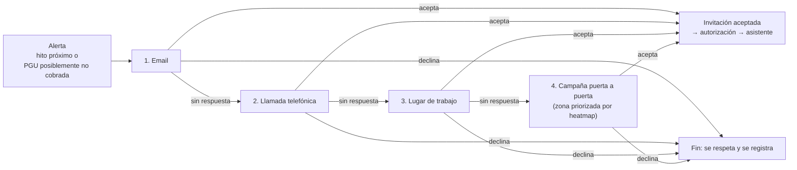

# Contacto escalonado y campañas por heatmap

Diseño de las piezas nuevas de [[0005-asistente-contacto-escalonado]]. Los plazos y umbrales de esta nota son **propuestas para la demo**, no parámetros institucionales.

## Escalera de contacto

| Etapa | Se salta si… | Espera antes de escalar (propuesta) | Cuenta como respuesta |
|---|---|---|---|
| 1. Email | No hay email registrado | 7 días | Abre el enlace y acepta o declina |
| 2. Llamada | No hay teléfono | 3 intentos en 5 días | Contesta y acepta o declina |
| 3. Lugar de trabajo | No trabaja actualmente o no hay empleador | 7 días | La persona se comunica |
| 4. Puerta a puerta | — (última etapa) | Según la planificación de la campaña | Visita con respuesta |

Reglas:
- **Declinar detiene todo.** No se escala a quien dijo que no.
- **Una persona, una escalera activa.** Si llega otra alerta, se suma a la misma escalera.
- **Cada intento queda en el caso**: canal, fecha, resultado y quién lo hizo. Es lo que verá el ejecutivo.
- **El contacto laboral no revela nada**: el mensaje al empleador solo pide que la persona se comunique con ChileAtiende. No menciona beneficios, montos ni datos personales.
- **La demo usa un reloj simulado**, para mostrar en minutos una escalera que en la realidad dura semanas.

## Heatmap de campañas puerta a puerta
**Objetivo:** proponer dónde ir, en vez de recorrer al azar.

- **Unidad territorial:** comuna, que es suficiente para planificar y no expone direcciones.
- **Valor de cada zona:** personas que llegaron a la etapa 4 sin respuesta, ponderadas por prioridad. Por ejemplo, pesan más la posible PGU no cobrada, un hito más próximo o un antecedente faltante.
- **Salida:** un ranking de zonas con el número de personas y su prioridad, más el mapa. Es una propuesta de campaña: el equipo de terreno decide.
- **Privacidad:** no se muestran zonas con menos de 5 personas, para evitar identificar a alguien. El mapa no muestra nombres ni direcciones; esos se entregan solo al equipo asignado a la visita.
- **Tecnología:** Streamlit con pydeck o folium, sobre los centroides de cada comuna. Basta con una tabla de comuna → coordenadas, sin necesidad de un GIS.

## Datos que faltan
El [[datos-dataset-A]] **no trae** email, teléfono, empleador, dirección ni comuna; el README lo dice explícitamente ("no se identifica empleador"). Sin esos datos no hay escalera ni heatmap.

| Opción | Pros | Contras |
|---|---|---|
| A. Pedir a los mentores un dataset con datos de contacto (¿dataset B?) | Datos del evento, defendibles en el pitch | Puede no existir |
| B. Capa sintética propia (`data/synthetic/contacto.csv`, semilla fija) | Desbloquea la demo hoy | Hay que rotularla como sintética en todas partes |

**Recomendación:** preguntar primero (A). Si no hay respuesta, avanzar con la B:
- emails `@example.com`;
- teléfonos ficticios con un prefijo evidente;
- empleadores ficticios solo para quien `trabaja_actualmente = true`;
- comuna asignada según una distribución plausible;
- campos vacíos en una fracción de las personas, para que la escalera tenga que saltar etapas.

## Acompañamiento y back-office
- **Persona:** checklist de documentos (pendiente, recibido, validado), pasos del trámite explicados por el asistente y derivación a un ejecutivo con hora o canal acordado.
- **Ejecutivo y trabajador social**, en la ficha del beneficiario:
  - datos recopilados, con su fuente y fecha;
  - consentimientos;
  - historial de la escalera de contacto;
  - documentos;
  - estado de cada solicitud: *orientación preliminar → en trámite → resuelta por el organismo*;
  - un resumen del caso redactado por el asistente, con citas a la información del caso.
- **Derivación:** el asistente arma un resumen para el ejecutivo, que así no tiene que volver a preguntar lo que ya se sabe.

## Impacto en el código existente
| Pieza | Cambio |
|---|---|
| `src/contracts` (T02) | Nuevos valores de `Channel` (email, llamada, laboral, terreno); `ContactAttempt`; `Campaign`; `DocumentItem`; `RequestStatus`; ejecutivo asignado en `Case` |
| `src/agent` (T04) | Herramientas de documentos y de derivación; el contexto del caso incluye el historial de contacto |
| API y casos | Endpoints de la escalera, documentos y derivación |
| Frontend | Chat estilo ChileAtiende, ficha del beneficiario y vista de campañas con el heatmap |
