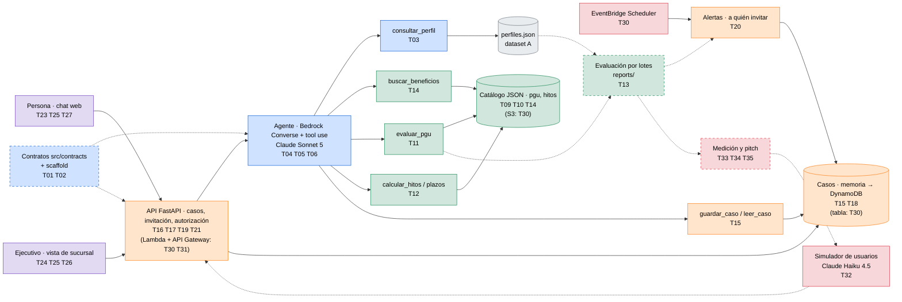

# Equipo — 5 integrantes, 35 tareas

Plan de trabajo sobre [[arquitectura-chileatiende]] (MVP jubilación + PGU, [[0004-mvp-jubilacion-pgu]], datos en [[datos-dataset-A]]). Sigue la experiencia objetivo del PPT institucional, resumida en [[contexto-compartido-chileatiende]]: **detectar → invitar → autorizar → preparar ruta → acompañar → cerrar y anticipar**.

Cada integrante tiene un **frente**, sus **propias carpetas de código** y **una carpeta en `35-roles/`** con su board (7 tareas) y su bitácora. El avance de todos se ve junto en [[_avance]].

> Principio del PPT: la IA **orienta** y el organismo **resuelve**. `elegible` es una orientación preliminar, nunca una adjudicación de PGU.

## Equipo y frentes
| # | Integrante | Entorno | Frente | Carpetas propias |
|---|---|---|---|---|
| 1 | [[board-clemente\|Clemente]] | Claude Code + Codex | Agente e integración | `src/contracts/`, `src/agent/`, `src/tools/`, `50-prompts/` |
| 2 | [[board-johann\|Johann]] | Kiro IDE Pro | Reglas PGU, hitos y catálogo | `data/catalogo/`, `src/rules/`, `reports/`, `.kiro/` |
| 3 | [[board-jonmor\|Jonmor]] | Kiro IDE Pro | API, casos e invitaciones | `src/api/`, `src/cases/`, `src/alerts/` |
| 4 | [[board-bruno\|Bruno]] | Kiro IDE Pro | Frontend y demo | `src/web/`, `20-arquitectura/ux-demo.md` |
| 5 | [[board-jp\|Jp]] | Kiro IDE Pro | Infra, simulador, medición y pitch | `infra/`, `src/sim/`, `60-pitch/` |

## Mapa de tareas sobre el pipeline
Es el mismo pipeline de [[arquitectura-chileatiende]], con cada componente coloreado según quién lo construye y las tareas que le corresponden. Los nodos con borde punteado son apoyos que no forman parte del flujo en producción.

| Color | Integrante | Tareas |
|---|---|---|
| 🟦 Azul | [[board-clemente\|Clemente]] | T01–T07 |
| 🟩 Verde | [[board-johann\|Johann]] | T08–T14 |
| 🟧 Naranjo | [[board-jonmor\|Jonmor]] | T15–T21 |
| 🟪 Morado | [[board-bruno\|Bruno]] | T22–T28 |
| 🟥 Rojo | [[board-jp\|Jp]] | T29–T35 |
| ⬜ Gris | Dato entregado | — |

Tareas transversales, sin un componente propio en el pipeline:
- 🟦 **T07**: revisión de PR, merges y congelamiento de `main`.
- 🟩 **T08**: steering de Kiro, común a todos.
- 🟪 **T22** (wireframe) y **T28** (guion de la demo).
- 🟥 **T29**: preguntas a los mentores y `cdk bootstrap`.

Si el diagrama no se ve con colores, revisa que la vista de lectura de Obsidian esté activa (`Ctrl+E`).

## Bloques de tiempo
| Bloque | Cuándo | Meta |
|---|---|---|
| **B1** | Mié 14 · 14:30–21:00 | Scaffold, contratos y datos listos. Cada frente arranca con mocks. |
| **B2** | Jue 15 · 09:00–14:00 | Piezas funcionando por separado, con tests. |
| **B3** | Jue 15 · 14:00–21:00 | Integración de punta a punta + deploy + pitch. |
| **B4** | Vie 16 · 09:00–10:15 | Solo estabilizar, ensayar y entregar. **El desarrollo cierra a las 10:15** (confirmar en T29). |

## Hitos de integración
- **Mié 18:00**: T01 + T02 (scaffold y contratos) en `main`. A partir de ahí todos importan los modelos desde `src/contracts/`.
- **Mié 21:00**: `consultar_perfil`, `pgu.json` + `hitos.json` y el repositorio de casos en memoria, en `main`.
- **Jue 14:00**: agente por CLI + API con agente falso + vistas con mocks.
- **Jue 18:00**: demo de punta a punta en local (invitación → autorización → ruta → chat → sucursal).
- **Jue 21:00**: congelamiento de funcionalidades. Desde aquí solo correcciones.
- **Vie 09:30**: `main` congelado. Lo que no esté, no entra.

Prioridad: **P0** = imprescindible para la demo · **P1** = suma puntos · si falta tiempo, se cae primero lo P1.

## Reglas de trabajo
- **Ramas**: `<nombre>/T<nn>-<descripcion>` (por ejemplo, `johann/T11-evaluar-pgu`). Codex usa `codex/T<nn>`. PR a `main`, y Claude revisa (T07).
- **Contratos primero**: nadie cambia `src/contracts/` sin avisar a Clemente. Si necesitas un campo, pídelo.
- **Mocks mientras tanto**: front, API y agente arrancan con datos falsos con la forma de los contratos y no esperan a los demás.
- **Kiro**: usar specs en `.kiro/specs/T<nn>/`, una por tarea. El steering (T08) es común.
- **Al tomar una tarea**: muévela a "En curso" en tu board. Al terminar, pásala a "Hecho" y anota el commit en tu bitácora.
- **Cada uno edita solo su carpeta de `35-roles/`**: así los commits de notas no chocan entre integrantes.
- **Commits**: empiezan con el ID de la tarea (`T11: evaluar_pgu con precedencia de estados`).
- **Regla del dominio**: elegibilidad, montos e hitos salen de código y del catálogo con fuente, nunca del LLM. Sin autorización no se consulta el perfil ampliado.

## Ruta crítica
`T01 → T02 → T03 + T09 → T11 + T12 → T04 → T16 + T21 → T06 → T25 → T28`
Si algo de esta cadena se atrasa, se avisa al tiro y se reasigna gente.
